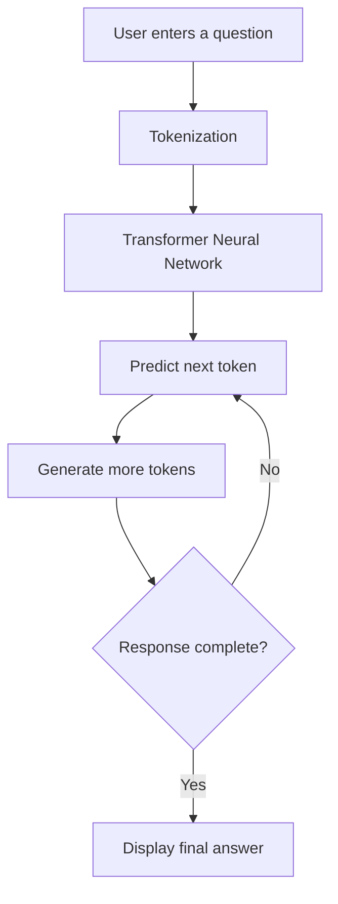

# How Large Language Models (LLMs) Work

## 1. What is an LLM?

LLM stands for Large Language Model.

It is an AI model trained using a large amount of text data, such as books, articles, websites, and documents.

An LLM understands patterns in language and generates human-like answers based on the input given by a user.

Examples of LLMs include ChatGPT, Google Gemini, and Llama.

## 2. How does an LLM work?

An LLM works through a series of steps:

1. **User Input:** The user enters a question or instruction.
2. **Tokenization:** The model breaks the input into smaller pieces called tokens.
3. **Processing:** The model processes these tokens using a neural network architecture called Transformer.
4. **Prediction:** The model predicts the next suitable token based on the previous tokens.
5. **Generation:** It repeats the prediction process to generate more tokens.
6. **Output:** The generated tokens are converted into readable text and shown to the user.

## 3. LLM Working Diagram

## 4. What is a Transformer?

A Transformer is a neural network architecture used by many modern LLMs.

It uses a mechanism called Attention to understand how different words in a sentence are related to each other.

For example, in the sentence "The laptop stopped working because it was damaged", attention helps the model understand that "it" refers to the laptop.

## 5. What is Tokenization?

Tokenization is the process of splitting text into smaller units called tokens.

For example:

Input: "Hello, how are you?"

The tokenizer converts the sentence into tokens that the model can process.

A token can be a complete word, part of a word, or punctuation.

## 6. What is Prompting?

A prompt is the question or instruction given to an AI model.

For example:

"Explain consumer rights in simple words."

A clear prompt helps the model understand what type of answer the user expects.

## 7. How can LLMs help GrahakNyay?

LLMs can help GrahakNyay by:

- Understanding consumer questions written in everyday language.
- Explaining legal provisions in simple words.
- Summarizing consumer protection rules.
- Helping users understand complaint procedures.
- Generating easy-to-understand responses based on verified legal information.

However, LLMs can sometimes generate incorrect information. Therefore, legal answers should be checked against official government sources.

## 8. Important Note About GrahakNyay

The current GrahakNyay implementation uses FastAPI, TF-IDF, and cosine similarity to search consumer-law records.

It does not currently use an LLM to generate answers.

An LLM can be integrated in a future development stage to improve question understanding and answer generation.

## Conclusion

An LLM is an AI model that processes text and generates responses by predicting tokens. It can help applications like GrahakNyay make complex consumer-law information easier to understand.
